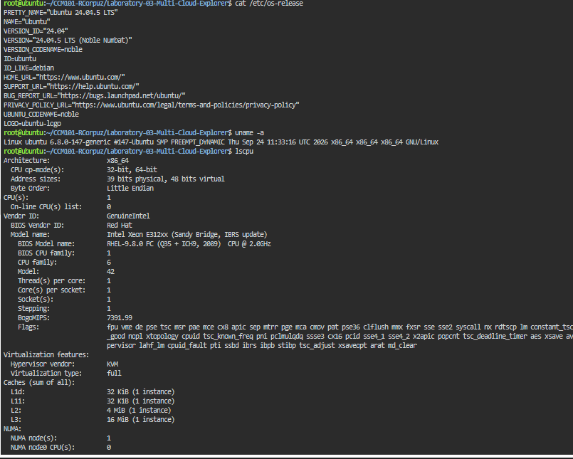

# Laboratory 03: Multi-Cloud Explorer

## Linux Investigation (KillerCoda)
| Item | Result |
|---|---|
| Operating System | (galing sa os-release) |
| CPU | (galing sa lscpu) |
| Memory | (galing sa free -h) |
| Disk Space | (galing sa df -h) |

## If this server were migrated to the cloud, which services could host it?
- **AWS:** Amazon EC2 (or Lightsail for small workloads)
- **Azure:** Azure Virtual Machines
- **GCP:** Compute Engine

(Dagdagan mo ng sarili mong paliwanag: bakit VM ang match sa isang Linux server?)

## Files
- [AWS Research](aws-research.md)
- [Azure Research](azure-research.md)
- [GCP Research](gcp-research.md)
- [Platform Comparison](cloud-platform-comparison.md)
- [Client Recommendations](client-recommendations.md)
- [Reflection](reflection.md)
