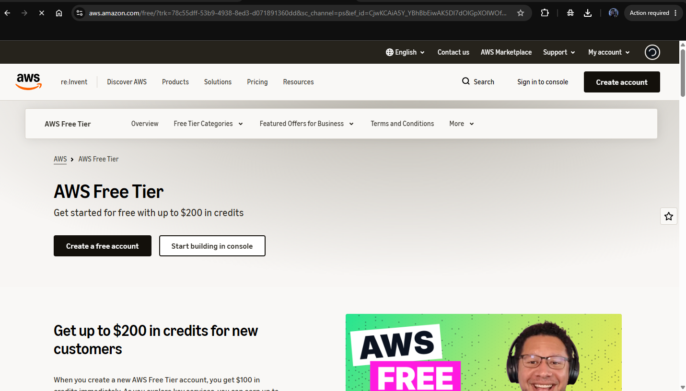

# Amazon Web Services (AWS) Research

## Brief Overview

Amazon Web Services (AWS) is a cloud computing platform provided by Amazon. It offers different services that allow businesses and individuals to store data, run applications, manage servers, and use computing resources through the internet. AWS helps users access technology without buying and maintaining their own physical servers.

## Global Infrastructure

AWS has a global infrastructure organized into Regions, Availability Zones, and Edge Locations. According to the official AWS Global Infrastructure website, AWS currently operates 39 geographic Regions and 124 Availability Zones. It also has more than 750 CloudFront Points of Presence and 15 regional edge caches around the world. These locations help AWS provide reliable, secure, and faster cloud services to users.

Source: https://aws.amazon.com/about-aws/global-infrastructure/

## Cloud Management Console

The AWS Management Console is a web-based platform that allows users to access and manage different AWS services. Users can create virtual servers, store files, configure networks, and manage security settings using a web browser.

AWS Homepage:

Website: https://aws.amazon.com/console/

## Four Core Services

1. **Amazon EC2 (Elastic Compute Cloud):** Amazon EC2 provides virtual servers that allow users to run applications and websites without purchasing physical computers.

2. **Amazon S3 (Simple Storage Service):** Amazon S3 is an online storage service that allows users to store, access, and manage files, documents, images, and backups.

3. **Amazon VPC (Virtual Private Cloud):** Amazon VPC allows users to create a private virtual network where they can manage their cloud resources and control network access.

4. **AWS IAM (Identity and Access Management):** AWS IAM helps users manage accounts, permissions, and access to AWS services. It helps protect cloud resources by allowing administrators to control who can access them.

## Three Advantages

1. **Cost Savings:** AWS helps businesses save money because they do not need to purchase expensive physical servers and other computer equipment. They only pay for the cloud services and resources they use.

2. **Scalability:** AWS allows businesses to increase or decrease their computing resources depending on their needs. This makes it easier to handle more users and workloads.

3. **Reliability:** AWS provides reliable cloud services through its global infrastructure. Businesses can use multiple Availability Zones to help keep their applications and data available.

## Typical Enterprise Use Cases

Businesses use AWS for different purposes, such as hosting websites and applications, storing important files, creating data backups, running databases, and analyzing large amounts of information. Companies can also use AWS to develop and deploy software without maintaining their own physical servers.

## Sources

- https://aws.amazon.com/
- https://aws.amazon.com/about-aws/
- https://aws.amazon.com/about-aws/global-infrastructure/
- https://aws.amazon.com/ec2/
- https://aws.amazon.com/s3/
- https://aws.amazon.com/vpc/
- https://aws.amazon.com/iam/

