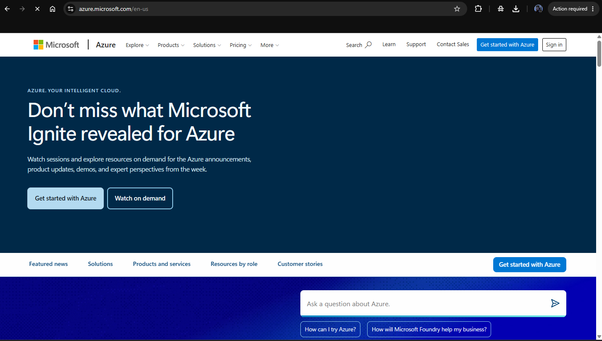

# Microsoft Azure Research

## Brief Overview

Microsoft Azure is a cloud computing platform developed by Microsoft. It provides services that allow businesses and individuals to build applications, store data, manage virtual machines, and use computing resources through the internet. Azure helps organizations manage their IT infrastructure without maintaining their own physical servers.

## Global Infrastructure

Microsoft Azure has a global infrastructure consisting of geographic Regions and Availability Zones. Regions contain datacenters that provide cloud services in different parts of the world. Availability Zones are separate physical locations within a region that help protect applications and data from infrastructure failures.

Source: https://learn.microsoft.com/en-us/azure/reliability/regions-overview

## Cloud Management Console

The Azure Portal is a web-based management platform that allows users to create, configure, and manage Azure resources. Users can manage virtual machines, databases, storage accounts, and networking services using a web browser.

Azure Homepage:

Website: https://portal.azure.com/

## Four Core Services

1. **Azure Virtual Machines:** Provides virtual computers that allow users to run applications and operating systems in the cloud.

2. **Azure Blob Storage:** Allows users to store large amounts of unstructured data such as images, videos, documents, and backups.

3. **Azure Virtual Network:** Allows users to create private networks and securely connect their cloud resources.

4. **Microsoft Entra ID:** Helps manage user identities, authentication, and access to cloud resources.

## Three Advantages

1. **Scalability:** Azure allows businesses to increase or decrease their cloud resources depending on their needs.

2. **Security:** Azure provides security features that help protect applications, accounts, and important business data.

3. **Flexibility:** Azure supports different operating systems, programming languages, databases, and application platforms.

## Typical Enterprise Use Cases

Businesses use Microsoft Azure to host websites and applications, store company files, manage databases, create backups, and develop software. Organizations also use Azure for data analytics, artificial intelligence, and business operations.

## Sources

- https://azure.microsoft.com/
- https://learn.microsoft.com/azure/
- https://learn.microsoft.com/en-us/azure/reliability/regions-overview
- https://azure.microsoft.com/products/virtual-machines/
- https://azure.microsoft.com/products/storage/blobs/
- https://azure.microsoft.com/products/virtual-network/
- https://www.microsoft.com/security/business/identity-access/microsoft-entra-id

