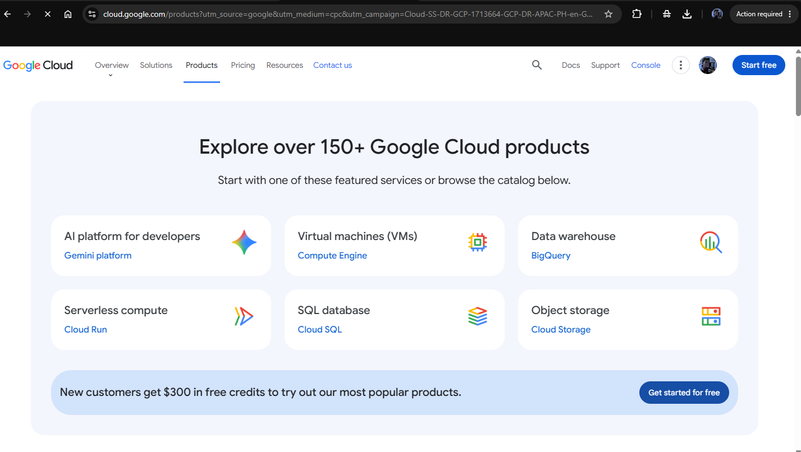

# Google Cloud Platform (GCP) Research

## Brief Overview

Google Cloud Platform (GCP), now commonly called Google Cloud, is a cloud computing platform developed by Google. It provides services that allow users to build applications, store data, manage virtual machines, and use computing resources through the internet. It helps businesses develop and operate applications without purchasing and maintaining physical servers.

## Global Infrastructure

Google Cloud has a global infrastructure organized into Regions and Zones. Regions are geographical locations where Google Cloud resources are available, while Zones are separate deployment areas within a region. This infrastructure helps provide better performance, reliability, and redundancy for cloud applications.

Source: https://cloud.google.com/about/locations

## Cloud Management Console

The Google Cloud Console is a web-based platform that allows users to manage their cloud resources and services. Users can create virtual machines, manage storage, configure networks, and monitor their cloud projects using a web browser.

Google Cloud Homepage:

Website: https://console.cloud.google.com/

## Four Core Services

1. **Compute Engine:** Provides virtual machines that allow users to run applications and workloads in the cloud.

2. **Cloud Storage:** Allows users to store and access files, images, videos, backups, and other types of data.

3. **Google Cloud VPC:** Allows users to create virtual networks and manage communication between cloud resources.

4. **Cloud IAM (Identity and Access Management):** Helps administrators manage user permissions and control access to Google Cloud resources.

## Three Advantages

1. **Scalability:** Google Cloud allows businesses to adjust their computing resources based on their workload and requirements.

2. **Performance:** Google Cloud uses Google's global infrastructure to provide reliable connectivity and efficient cloud services.

3. **Data Management:** Google Cloud provides different storage and database services that help businesses manage and organize their information.

## Typical Enterprise Use Cases

Businesses use Google Cloud to host websites, run applications, store important files, manage databases, and analyze large amounts of data. Companies also use Google Cloud for artificial intelligence, machine learning, data processing, and software development.

## Sources

- https://cloud.google.com/
- https://cloud.google.com/docs
- https://cloud.google.com/about/locations
- https://cloud.google.com/compute
- https://cloud.google.com/storage
- https://cloud.google.com/vpc
- https://cloud.google.com/iam/docs

