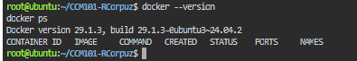
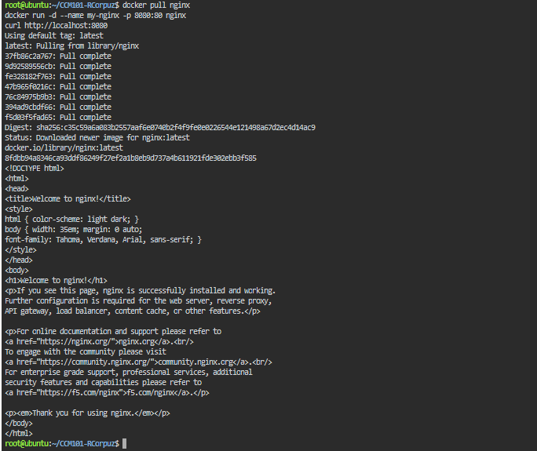
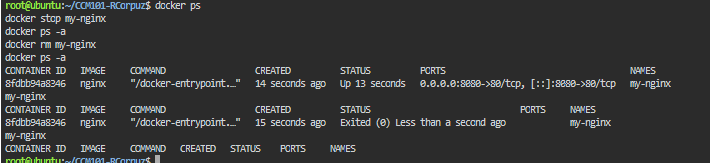

# Docker Deployment

## Deployment Commands

| Command | What it did |
|---|---|
| `docker --version` | Displayed the installed Docker version, confirming Docker is installed. |
| `docker ps` | Listed the currently running containers (none yet at first). |
| `docker pull nginx` | Downloaded the official Nginx image from Docker Hub. |
| `docker run -d --name my-nginx -p 8080:80 nginx` | Started the Nginx container in detached mode and mapped host port 8080 to container port 80. |
| `curl http://localhost:8080` | Sent an HTTP request to verify the web server returned the "Welcome to nginx!" page. |

## Container Lifecycle

1. `docker ps` - Listed all running containers, showing `my-nginx` as up and running.
2. `docker stop my-nginx` - Gracefully stopped the running Nginx container.
3. `docker ps -a` - Listed all containers including stopped ones, showing `my-nginx` with an Exited status.
4. `docker rm my-nginx` - Removed the stopped container completely from the system.

## Screenshots

