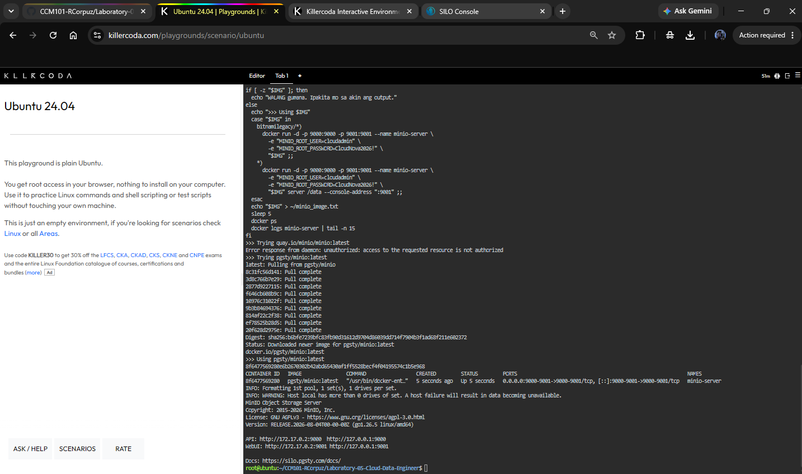
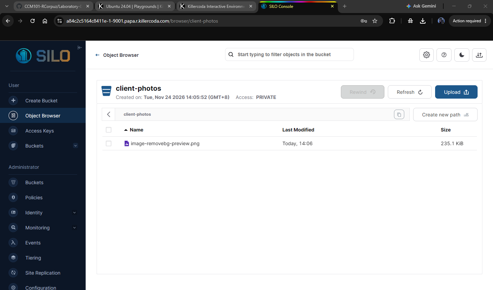

# MinIO Deployment Documentation

## 1. Docker Command Used

```bash
docker run -d -p 9000:9000 -p 9001:9001 --name minio-server \
-e "MINIO_ROOT_USER=cloudadmin" \
-e "MINIO_ROOT_PASSWORD=CloudNova2026!" \
minio/minio server /data --console-address ":9001"
```

## 2. Web Console Port

**Port 9001** (accessed through the KillerCoda Traffic / Ports tab). Port 9000 is the S3-compatible API port.

## 3. Bucket Created

**client-photos**

## 4. Explanation of the `-e` Flags (Environment Variables)

- `-e "MINIO_ROOT_USER=cloudadmin"` sets the administrator username used to log in to the MinIO web console.
- `-e "MINIO_ROOT_PASSWORD=CloudNova2026!"` sets the administrator password for that account.

The `-e` flag passes environment variables into the container when it starts, so the server is configured automatically without editing any config file inside the container.

## 5. Steps Performed

1. Launched a KillerCoda Ubuntu Playground.
2. Ran the `docker run` command to download and start MinIO.
3. Verified the container was running with `docker ps`.
4. Opened port 9001 through the Traffic / Ports tab and logged in to the console.
5. Created the `client-photos` bucket.
6. Uploaded a sample file to the bucket.

## 6. Screenshots

### MinIO Deployed


### Bucket and Uploaded File

