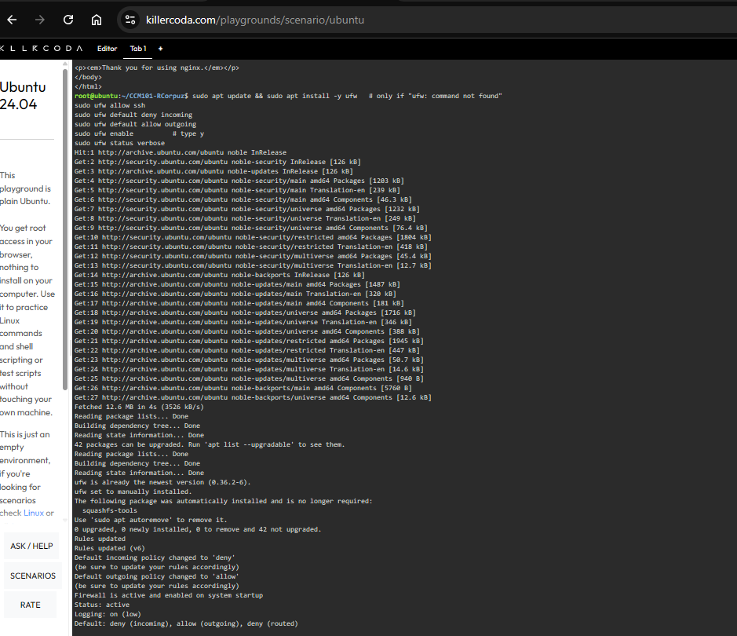
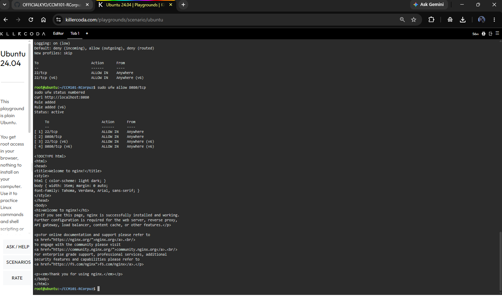

# Firewall Configuration

## 1. Allow SSH
```bash
sudo ufw allow ssh
```

## 2. Set Default Deny Policy
```bash
sudo ufw default deny incoming
sudo ufw default allow outgoing
```

## 3. Allow Port 8080
```bash
sudo ufw allow 8080/tcp
```

## 4. Enable and Verify
```bash
sudo ufw enable
sudo ufw status verbose
sudo ufw status numbered
```

## What if `ufw enable` runs before `ufw allow ssh`?
The default deny policy would immediately block all incoming connections, including SSH on port 22, so the administrator would be locked out of the server.

## Evidence
- 
- 
