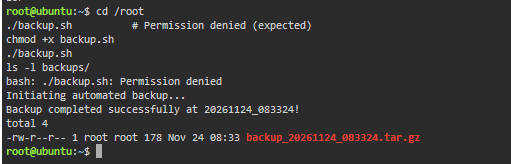
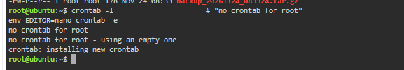

# Backup Script Guide

## Purpose
This guide explains the automated backup script built for CloudNova Technologies. It compresses the `app-data` directory into a timestamped `.tar.gz` file every night so the IT staff no longer need to back up manually.

## Full Script (`backup.sh`)
```bash
#!/bin/bash
# Automated Backup Script for CloudNova Technologies

SOURCE_DIR="app-data"
BACKUP_DIR="backups"
TIMESTAMP=$(date +"%Y%m%d_%H%M%S")

echo "Initiating automated backup..."

# Create the backup directory if it does not exist
mkdir -p $BACKUP_DIR

# Compress the source directory into a tarball (.tar.gz)
tar -czf $BACKUP_DIR/backup_$TIMESTAMP.tar.gz $SOURCE_DIR

echo "Backup completed successfully at $TIMESTAMP!"
```

## What `chmod +x` Does
By default, Linux treats a new text file as non-executable, so running `./backup.sh` gives "Permission denied". The command `chmod +x backup.sh` adds the **execute** permission to the file, which allows the system to run it as a program.

## Cron Expression
```
0 2 * * * /root/backup.sh
```

| Field | Value | Meaning |
|-------|-------|---------|
| Minute | `0` | At minute 0 (top of the hour) |
| Hour | `2` | At 2 AM (24-hour format) |
| Day of Month | `*` | Every day of the month |
| Month | `*` | Every month |
| Day of Week | `*` | Every day of the week |

Together, this runs `/root/backup.sh` every night at exactly 2:00 AM.

## Screenshots


